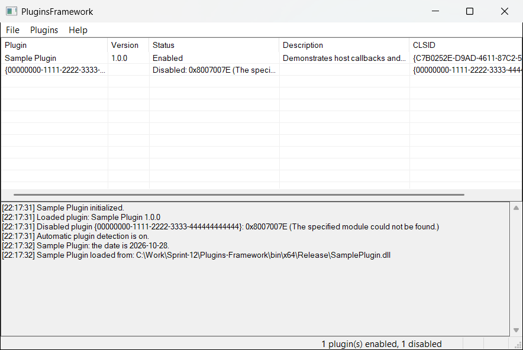
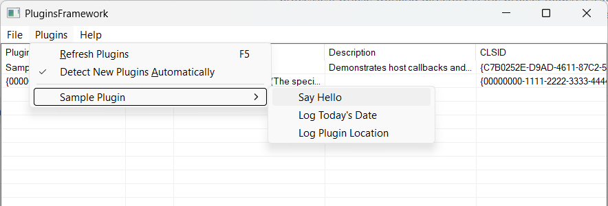

# PluginsFramework

An MFC desktop shell that turns features on and off at runtime depending on which
in-process COM plugins are registered. Plugins join the `CATID_PluginsFramework`
component category. The host finds them with `ICatInformation`, loads them with
`CoCreateInstance`, and adds their commands to a **Plugins** menu.



The list shows every CLSID found in the category. **Sample Plugin** loaded and is
enabled. The second entry is registered, but its DLL is missing, so it's listed as
disabled with the failing HRESULT and left out of the menu. The log pane below shows
plugin lifecycle events and output from plugin commands, which plugins write
through `IPluginHost::LogMessage`.



Each enabled plugin gets an entry under **Plugins**. A plugin that exposes several
commands through `IPluginCommands` gets a submenu, as shown above.

## Layout

| Path | Contents |
|---|---|
| `Shared/IPlugin.h` | COM contract: `IPlugin`, optional `IPluginCommands`, host-side `IPluginHost`, and all GUIDs |
| `Host/PluginManager.*` | `CPluginManager`: discovery via component categories, lifetime, command dispatch |
| `Host/MainFrm.*` | `CMainFrame`: dynamic menu (`AppendMenu`), `ON_COMMAND_RANGE` routing, plugin list and log pane |
| `Host/PluginHost.*` | `CPluginHostServices`: the `IPluginHost` object passed to `IPlugin::Initialize` |
| `Host/RegistryWatcher.*` | `CRegistryWatcher`: background registry watch for automatic plugin detection |
| `Host/PluginsFramework.*` | `CWinApp` (`AfxOleInit` puts the UI thread in an STA) and resources |
| `SamplePlugin/` | Self-registering ATL in-process plugin with three commands |
| `PluginTemplate/` | Plain C++ (no ATL) plugin template that starts new plugins |
| `tools/New-Plugin.ps1` | Creates a new plugin project from `PluginTemplate` |
| `docs/PLUGIN_DEVELOPMENT.md` | Plugin developer guide: contract, registration, rules, troubleshooting |
| `.github/workflows/build.yml` | CI build, packaging, and automatic release tagging |
| `docs/screenshots/` | Images used in this README |

## Build

Open `PluginsFramework.sln` in Visual Studio 2026, or run:

```bash
msbuild PluginsFramework.sln /p:Configuration=Release /p:Platform=x64
```

Output goes to `bin\<Platform>\<Configuration>\`. You need the **C++ MFC** and **C++ ATL**
components. The projects use `$(DefaultPlatformToolset)`, so they build unchanged with
Visual Studio 2022 (`v143`) or 2026 (`v145`).

## CI and releases

[`.github/workflows/build.yml`](.github/workflows/build.yml) runs on GitHub Actions:

- **Every push and pull request to `main`:** builds Release x64 and Win32 on
  `windows-latest`. Each platform is packaged as a zip artifact containing
  `PluginsFramework.exe`, `SamplePlugin.dll`, this README, and an `sdk/` folder.
  The `sdk/` folder holds `Shared/IPlugin.h`, the `PluginTemplate` source,
  `tools/New-Plugin.ps1`, and the developer guide, so third parties can build
  plugins without cloning the repository.
- **Every push to `main`:** after both builds pass, the workflow calculates the
  next version, creates the `vX.Y.Z` tag on the built commit, and publishes a GitHub
  Release with both zips and auto-generated release notes.

The version bump is based on the commit messages since the last `v*` tag:

| Commit message contains | Bump | Example |
|---|---|---|
| `BREAKING CHANGE`, a `!` type (`feat!:`, `fix(host)!:`), or `#major` | major | `v1.4.2 → v2.0.0` |
| `feat:` / `feat(scope):` or `#minor` | minor | `v1.4.2 → v1.5.0` |
| anything else | patch | `v1.4.2 → v1.4.3` |
| `[skip release]` | no release | build still runs |

The first release is `v1.0.0`. Pushes that only change Markdown or `docs/` don't
trigger the workflow. To force a specific bump, run the workflow from the
**Actions** tab (**Run workflow**) and choose `patch`, `minor`, or `major`.

Release creation uses the built-in `GITHUB_TOKEN`. If the repository's
**Settings → Actions → General → Workflow permissions** is set to read-only, the
job's explicit `contents: write` permission still applies, unless an organization
policy blocks it.

## Registering plugins

The plugin's bitness must match the host's: an x64 host only loads x64 plugins.

Machine-wide registration (needs an elevated prompt):

```bash
regsvr32 bin\x64\Release\SamplePlugin.dll
```

```bash
regsvr32 /u bin\x64\Release\SamplePlugin.dll
```

Per-user registration (no elevation; writes to `HKCU\Software\Classes`):

```bash
regsvr32 /n /i:user bin\x64\Release\SamplePlugin.dll
```

```bash
regsvr32 /u /n /i:user bin\x64\Release\SamplePlugin.dll
```

Plugins that are in the category but fail to load (missing DLL, wrong bitness, or a
failed `Initialize`) are left out of the menu. They show in the plugin list as
**Disabled** with the failing HRESULT.

## Automatic plugin detection

The host notices newly installed and uninstalled plugins by itself; no restart or
Refresh is needed. A background thread watches the COM registration keys
(`HKCU\Software\Classes` and `HKLM\Software\Classes\CLSID`) with
`RegNotifyChangeKeyValue`. When something changes, the host waits 750 ms for
`regsvr32` to finish writing, then syncs with the component category:

- **Newly registered plugins** are created, initialized, and added to the menu and list.
- **Unregistered plugins** are shut down and released, and their DLL is unloaded so
  an uninstaller can delete it.
- **Plugins that are still registered** keep running and aren't reloaded.
- **Disabled plugins** are retried, so fixing one (for example, restoring its DLL)
  enables it on the next change.

The log pane records each change ("Loaded plugin: …", "Unloaded plugin
(unregistered): …"). While a plugin command is running (for example, showing a
message box), syncs are postponed until it returns.

Turn detection on or off with **Plugins → Detect New Plugins Automatically**. It's
on by default, and the choice is saved in `HKCU\Software\PluginsFramework`.
**Refresh Plugins** (F5) still does a full reload: every plugin is released and
loaded again. Use it after re-registering an updated build of a plugin that's
already loaded.

## Creating a new plugin

Use the scaffolding script. It copies [`PluginTemplate`](PluginTemplate/PluginTemplate.cpp),
renames the project, classes and display name, and generates a fresh CLSID:

```bash
powershell -ExecutionPolicy Bypass -File tools/New-Plugin.ps1 -Name ReportsPlugin -DisplayName "Reports" -AddToSolution
```

Fill in the `TODO(plugin)` sections in `ReportsPlugin/ReportsPlugin.cpp`, build,
and register it:

```bash
msbuild ReportsPlugin/ReportsPlugin.vcxproj /p:Configuration=Debug /p:Platform=x64
```

```bash
regsvr32 /n /i:user bin\x64\Debug\ReportsPlugin.dll
```

A running host shows **Reports** in its Plugins menu right away.

The template is plain C++ with no ATL, so every call the host relies on is visible:
the class factory, `DllGetClassObject`, `DllCanUnloadNow`, the registry keys, and
the `ICatRegister` calls. [`SamplePlugin`](SamplePlugin/SamplePlugin.cpp) shows the
same contract written with ATL, plus several commands through `IPluginCommands`.

**[docs/PLUGIN_DEVELOPMENT.md](docs/PLUGIN_DEVELOPMENT.md)** is the full developer
guide. It covers the call sequence, the required exports and registry keys, each
interface method's contract, threading and bitness rules, and an HRESULT
troubleshooting table.

### Design notes

- The interfaces are declared in plain C++ (`MIDL_INTERFACE`) without an IDL or
  proxy/stub DLL. That works because plugins are apartment-threaded in-proc servers
  created on the host's STA, so calls are never marshaled. If plugins ever need to
  run out of process or on other threads, move the declarations into an `.idl`
  and register a proxy/stub or type library.
- The host's menu command IDs come from the range `ID_PLUGIN_CMD_FIRST`–`ID_PLUGIN_CMD_LAST`
  (40000–40100). The host keeps a table that maps each ID to a plugin and that
  plugin's own command ID. The table is rebuilt whenever the plugin set changes.
- Registry notifications are armed on the watcher thread, because asynchronous
  `RegNotifyChangeKeyValue` registrations are tied to the thread that makes them.
  The plugins themselves are only ever touched on the UI (STA) thread.
